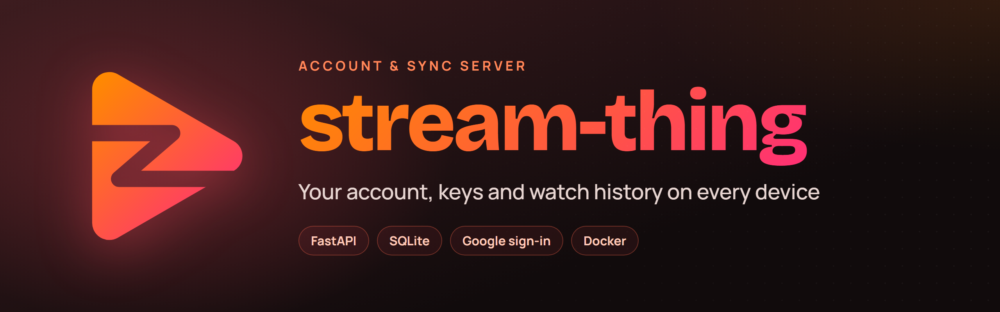
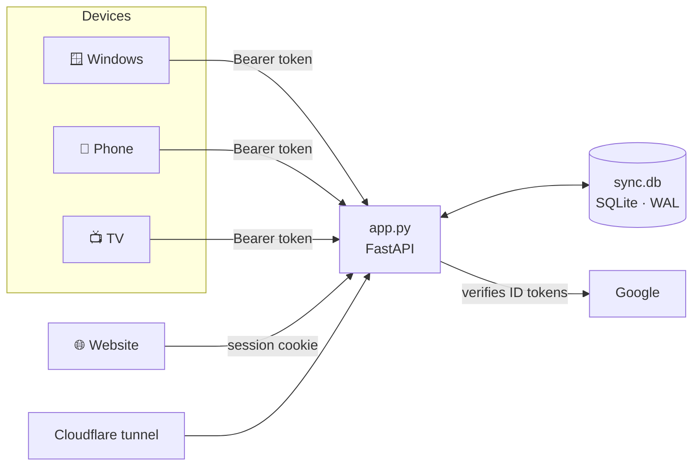
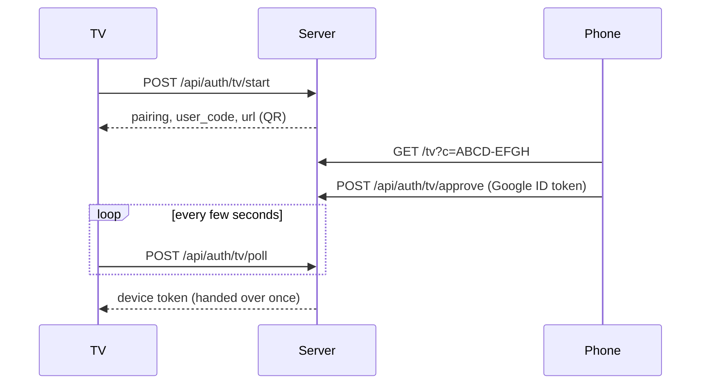

<div align="center">



<br>

[](https://sync.thestoreisclosed.co.uk)


[](LICENSE)

<h3>Your account, keys and watch history — on every device.</h3>

The small account and sync server behind [stream-thing](https://ziggygamedev.github.io/stream-thing-releases/).<br>
One file (`app.py`) · one page (`static/index.html`) · one SQLite database.

**[Run locally](#-run-locally)** ·
**[API](#-api)** ·
**[Security](#%EF%B8%8F-security)** ·
**[Configuration](#%EF%B8%8F-configuration)** ·
**[Deployment](#-deployment-cctv)**

</div>

<br>

## ✨ What it does

<table>
<tr>
<td width="50%" valign="top">

### 🔐 Sign in with Google
From inside the app — no passwords, no email verification. The first sign-in creates the account.

</td>
<td width="50%" valign="top">

### 🔑 Keys that travel
TorBox or Real-Debrid, MDBList and the aioratings poster key, **encrypted** on the server so a new device picks them up automatically.

</td>
</tr>
<tr>
<td valign="top">

### ⏯️ Watch progress &amp; My list
Synced between every device (this replaces Simkl in the app), per profile.

</td>
<td valign="top">

### ⚙️ Settings &amp; addons
Kept on the account, so every device has them — a TV, a phone and a PC each keep their own settings.

</td>
</tr>
<tr>
<td valign="top">

### 📺 TVs sign in from a phone
Through Google's own device flow, or a QR-code pairing on this server as the fallback.

</td>
<td valign="top">

### 🧹 Manage it on the web
Keys, signed-in devices, signing out and deleting the account, at [sync.thestoreisclosed.co.uk](https://sync.thestoreisclosed.co.uk).

</td>
</tr>
</table>



<br>

## 📡 API

All JSON. Errors are `{"error": "..."}` with a meaningful status:

| Status | Meaning |
|:---:|---|
| `400` | bad input |
| `401` | bad or missing token, or a rejected Google credential |
| `403` | missing CSRF header |
| `404` | not found |
| `429` | rate-limited |
| `502` | couldn't reach Google |
| `503` | not configured |

### In-app sign-in

Returns a device token. Signing in is also signing up: the first sign-in with a Google account creates it.

| Method | Path | Body | Notes |
|---|---|---|---|
| `POST` | `/api/auth/google` | `{"id_token", "device_name"}` | **Android.** Credential Manager's Google ID token. Its audience may be any ID in `GOOGLE_CLIENT_IDS` (plus `GOOGLE_CLIENT_ID`, always) — Credential Manager tokens carry the *web* client ID |
| `POST` | `/api/auth/google-code` | `{"code", "code_verifier", "redirect_uri", "device_name"}` | **Windows.** System-browser loopback flow with PKCE against the *desktop* client. The server exchanges the code at `https://oauth2.googleapis.com/token` with `GOOGLE_DESKTOP_CLIENT_ID` + `GOOGLE_DESKTOP_CLIENT_SECRET` and verifies the returned ID token (audience = desktop client). `redirect_uri` must be `http://127.0.0.1:<port>/...` or `http://localhost:<port>/...`; `code_verifier` 43–128 chars. 401 if Google rejects the code, 503 if the desktop secret isn't configured |

Both return `{"token": "<device token>", "account": {"email", "name"}}` and are
rate-limited per client IP (shared budget, 10/minute).

### Signing a TV in from a phone

For a TV that can't run Google's sign-in itself (Fire TV has no Google services).

<details>
<summary><b>Through Google</b> (preferred)</summary>

<br>

With `GOOGLE_TV_CLIENT_ID` and `GOOGLE_TV_CLIENT_SECRET` set (an OAuth client of type
"TVs and Limited Input devices"), `GET /api/auth/tv/google` gives the TV
`{"client_id", "client_secret"}`. The TV runs Google's device flow itself: it asks Google
for a code, shows `google.com/device` and the code, and waits on Google, not on this server.
The ID token it ends with goes to `POST /api/auth/google`, which accepts that client as an
audience. One request here per TV, however long the phone takes. 404 when not set up.

</details>

<details>
<summary><b>Through this server</b> (fallback)</summary>

<br>

The TV asks for a pairing and shows its link as a QR code; a phone opens the link, signs in
with Google on `/tv`, and the TV, asking every few seconds, is handed a device token of its own.



| Method | Path | Body | Notes |
|---|---|---|---|
| `POST` | `/api/auth/tv/start` | `{"device_name"}` | `{"pairing", "user_code", "url", "interval", "expires_in"}`. `pairing` is the TV's secret and never leaves it; `user_code` is 8 characters shown as `ABCD-EFGH`; `url` is `<PUBLIC_URL>/tv?c=<user_code>`. Pairings last 10 minutes. 20 per IP per 10 minutes |
| `POST` | `/api/auth/tv/poll` | `{"pairing"}` | `{"status": "pending"}`, `{"status": "expired"}`, or once approved `{"token", "account": {"email", "name"}}`, handed over once: the pairing is then gone |
| `GET` | `/tv?c=<user_code>` | | The phone's page: the code, and Google's sign-in button |
| `POST` | `/api/auth/tv/approve` | `{"user_code", "id_token"}` | The page's call. The ID token is checked as the website's is (audience `GOOGLE_CLIENT_ID`), that Google account is signed in under the TV's device name, and the result waits for the TV's next poll. `{"ok": true, "device_name"}`. The code is matched ignoring case, spaces and the dash; 404 for a wrong or expired one, 429 after 10 wrong codes per IP per 10 minutes |

Pairings are kept in memory: a restart drops any in progress and the TV shows a new code.

</details>

### Device API

`Authorization: Bearer <token>`

| Method | Path | Notes |
|---|---|---|
| `GET` | `/api/me` | `{"email", "name", "device": {"id", "name"}}` |
| `GET` | `/api/credentials` | `{"credentials": {...set keys only}, "updated_at": ms \| null}` |
| `PUT` | `/api/credentials` | `{"credentials": {...}}` merge: string sets, `""`/`null` removes, unknown key → 400, max 512 chars. Returns the GET shape |
| `GET` | `/api/progress?since=ms` | `{"progress": {"<videoId>": {"position", "duration", "watched", "updatedAt"}}, "now": ms}` |
| `POST` | `/api/progress` | `{"progress": {"<videoId>": {...}}}` → `{"ok": true, "now": ms}`. Newest `updatedAt` wins (ties go to the incoming write). ≤500 entries, videoId ≤200 printable ASCII chars |
| `GET` | `/api/list?since=ms` | My list: `{"list": {"<titleId>": {"type", "name", "poster", "addedAt", "removed", "updatedAt"}}, "now": ms}` |
| `POST` | `/api/list` | `{"list": {"<titleId>": {"type", "name", "poster", "addedAt", "updatedAt"}}}`, or `{"removed": true, "updatedAt"}` to take one off → `{"ok": true, "now": ms}`. Same rules as progress: newest `updatedAt` wins, removals are kept so they reach other devices. ≤500 entries |
| `GET` | `/api/profiles?since=ms` | `{"profiles": {"<id>": {"name", "color", "removed", "updatedAt"}}, "now": ms}` |
| `POST` | `/api/profiles` | `{"profiles": {"<id>": {"name", "color", "removed"?, "updatedAt"}}}` → `{"ok": true, "now": ms}`. Newest wins. Ids `[a-z0-9-]{1,40}`, name 1–40 chars, color `#rrggbb`, ≤12 profiles. Removing one deletes its progress and list; `main` can't be removed |
| `GET` | `/api/settings?device=tv\|phone\|desktop` | The app's settings for that kind of device: `{"settings": {...} \| null, "updatedAt": ms}`. A TV, a phone and a PC each keep their own copy |
| `PUT` | `/api/settings?device=…` | `{"settings": {...}, "updatedAt": ms}` → `{"ok": true, "stored": bool, "updatedAt": ms}`. Newest `updatedAt` wins (ties go to the incoming write); `stored` is false when the server's copy is newer. ≤200 KB |
| `GET` | `/api/addons` | The account's installed addons, in order: `{"addons": [{"url"}] \| null, "updatedAt": ms}`. Shared by every device and profile |
| `PUT` | `/api/addons` | `{"addons": [{"url"}], "updatedAt": ms}` → as settings. The whole list is replaced. ≤60 addons, http(s) addresses ≤2000 chars |
| `POST` | `/api/logout` | Revokes the calling token |

> [!TIP]
> **Profiles.** Progress and My list belong to a profile: add `?profile=<id>` to
> `/api/progress` and `/api/list` (GET and POST). Without it, the call is for `main`,
> which is also where everything synced before profiles existed lives. Keys are
> shared by every profile on the account.

Settings and addons are encrypted at rest like the keys: an addon's address can
carry its owner's own configuration.

**Credential keys:** `debrid_service` (`"torbox"` or `"realdebrid"`), `torbox`
(TorBox API key), `realdebrid` (Real-Debrid API token), `mdblist`, `poster`
(aioratings poster key).

<details>
<summary><b>How <code>since</code> works</b></summary>

<br>

Pass back the `now` from your previous GET/POST. The server returns rows whose
`changed_at` (its own clock when the row was last written) is `> since` — never compared
with the device's `updatedAt` — so a device whose clock runs behind can't hide updates
from the others. `now` is one millisecond behind the server clock so a write in the same
millisecond as a pull isn't missed; an entry may occasionally come back twice, which is
harmless with newest-wins merging. `updatedAt` decides which write wins; values in the
future are clamped to server time.

</details>

### Website API

Session cookie; non-GET requests need `X-Requested-With: sync`. The website is for
managing the account; devices sign in from inside the app.

| Method | Path | Notes |
|---|---|---|
| `POST` | `/api/web/google` | `{"credential": "<Google ID token>"}` (audience: `GOOGLE_CLIENT_ID` only) → sets the session cookie (60 days) |
| `GET` | `/api/web/me` | `{"email", "name", "picture"}` |
| `POST` | `/api/web/logout` | |
| `GET` `PUT` | `/api/web/credentials` | Same shapes as the device API |
| `GET` | `/api/web/devices` | `{"devices": [{"id", "name", "created_at", "last_used_at"}]}` |
| `DELETE` | `/api/web/devices/{id}` | Signs that device out |
| `DELETE` | `/api/web/account` | Deletes the user and everything belonging to them |

Pages: `/` (account: keys, devices, sign out, delete), `/privacy`, `/terms`, `/stats`.
`GET /healthz` → `{"ok": true}`.

### Bug reports (public)

The bug button in the app. No sign-in needed; with a device token, the account is noted on
the report.

| Method | Path | Body | Notes |
|---|---|---|---|
| POST | `/api/report` | `{"message"?, "screenshot"?, "version"?, "platform"?, "device"?, "page"?, "info"?, "playback"?, "logs"?, "diagnostics"?}` | → `{"id"}`. Needs a `message` or a `screenshot`. `screenshot` is a JPEG or PNG as base64 or a `data:` address, ≤3 MB (one that can't be read is left out, the report still arrives); `info` is an object of short plain values; `playback` is what was playing and how (≤100 KB), with `findings`, a list of plain sentences that head the issue; `logs` an object of texts. Body ≤6 MB. 6 per IP per hour |
| GET/HEAD | `/reports/shots/<name>` | | A report's screenshot. The name ends in 32 random characters and is only ever written into the issue filed from the report |

Each report is one file, `$DATA_DIR/reports/<id>.json`, with its screenshot in
`reports/shots/`.

**Reports become GitHub issues** when `GITHUB_TOKEN` and `GITHUB_REPO` are set. Within
moments of a report arriving, an issue is opened on that repo: the person's words quoted as
written, the screenshot, a table of version, platform, page and device, what the app
gathered, and the playback report folded away. It is labelled `bug-report`, `automated` and
`platform:<platform>`, and the issue's number and address are written back into the report's
file (`"issue"`). The account's email and the logs are not put in the issue: they stay in
the report's file.

- A report GitHub refuses is tried again every 10 minutes, 5 times. A refused token (401,
  403, 404) costs no tries: everything waiting is filed once the token is put right.
- One pass files at most 20, so a flood of reports is 20 issues and a log line, not hundreds.
- Reports from before this was switched on (no `"issue"` entry in the file) are left alone.
- The screenshot is shown in the issue by address, so it has to be reachable without signing
  in to anything: anyone given its full address can open it. Nothing lists the addresses.

### Anonymous usage counts (public)

What the app is used for, as totals per day. A report carries counts, the kind of device
and the app's version: no account, no device id, nothing about what was watched. It is sent
without a token (one sent with a token has it ignored), and the address it came from is
used for the rate limit only, in memory.

| Method | Path | Body | Notes |
|---|---|---|---|
| POST | `/api/usage` | `{"platform", "version", "counts": {"<key>": n}}` | → `{"ok": true}`. About once a day per device. Only the keys in `USAGE_KEYS` (`app.py`) are kept, each up to its limit; anything else is dropped without failing the report. `platform` and `version` outside what's known are filed as `other`. Body ≤8 KB. 120 per IP per day |
| POST | `/api/live/watching` | `{"channel", "token"}`, or with `"leave": true` | → `{"watching", "every"}`. Sent every `every` seconds while one of the app's live channels is on. `token` is 16 to 40 random characters made up on tuning in. `watching` is 0 below 2. `every` 0: stop sending. Held in memory only. 30 per IP per minute |
| GET | `/api/live/viewers` | | → `{"viewers": {"<channel>": n}, "every"}`: channels with 2 or more watching. `Cache-Control: public, max-age=30` |
| GET | `/api/stats?days=30` | | `Authorization: Bearer <STATS_TOKEN>`. → `{"today", "since", "rows": [[day, platform, version, key, n]], "watching"}`. 404 without `STATS_TOKEN` |

Counts are held in memory and written once a minute to one table, `usage`, a row per day,
platform, version and key. Devices in use are counted without telling them apart: a
device's first report of a day, week and month carries `active.day`, `active.week` and
`active.month`, and those add up. Each beat on a live channel adds to that channel's
`live.mins.<channel>` for the day, and the most watching at once is kept as
`live.peak.<channel>`.

`/stats` is the page that shows it all, behind `STATS_TOKEN`.

**What is watched.** `GET /api/stats/watching?days=30` (same password; `days=0` for
everything) adds up the watch progress and My list that signed-in accounts sync: top
titles, shows against films, genres, decades, countries, IMDb scores, plays by day and by
hour (UK time), how far through people get, what is on the way up, what is saved and never
started, and signed-in devices by kind. Only totals leave the server, never an account or
one person's history; with a handful of accounts a total can still be one person's, which
is what the password is for. Titles are named from Cinemeta (and the Kitsu addon for anime),
asked about the title's id alone, a few hundred at a time, and kept in the `titles` table;
`TITLE_LOOKUP=0` turns the lookups off. The privacy page says all of this.

To let Cloudflare answer the guide's requests, add a Cache Rule for
`/api/live/viewers` (eligible for cache, respect origin TTL). Without it they reach this
server, where each is a read from memory.

### App updates

Public, read-only.

| Method | Path | Notes |
|---|---|---|
| `GET` `HEAD` | `/updates/latest.json` | The newest published build, served from `$DATA_DIR/updates/latest.json` with `Cache-Control: no-cache`. 404 `{"error": "no update published"}` if there is none, 503 if the file isn't valid JSON |
| `GET` `HEAD` | `/updates/files/<name>` | A build from `$DATA_DIR/updates/`. Only `.apk` (`application/vnd.android.package-archive`) and `.exe` (`application/octet-stream`); names are `[A-Za-z0-9][A-Za-z0-9._-]*`, nothing else (and no subdirectories) is reachable. Supports `Range` |

<details>
<summary><b>Example <code>latest.json</code></b></summary>

<br>

```json
{
  "version": "0.3.0",
  "notes": "What changed",
  "published": "2026-10-29T20:00:00.000Z",
  "android": {
    "arm64": {"url": "/updates/files/stream-thing-0.3.0-arm64.apk", "sha256": "…", "size": 123},
    "armv7": {"url": "/updates/files/stream-thing-0.3.0-armv7.apk", "sha256": "…", "size": 123}
  },
  "windows": {"url": "/updates/files/stream-thing-0.3.0-windows.exe", "sha256": "…", "size": 123}
}
```

</details>

URLs are relative to this server. The server never writes here: stream-thing's
`scripts/publish-update.mjs` uploads the files with `scp` (to
`/mnt/data/stream-thing-sync/updates/` on the box), then `latest.json` last, each
renamed into place so a half-uploaded file is never served.

> [!NOTE]
> New releases live on GitHub, in [stream-thing-releases](https://github.com/ZiggyGameDev/stream-thing-releases/releases).
> `latest.json` is still copied here for copies of the app from before the move.

<br>

## 🛡️ Security

- 🔒 API keys are encrypted with **Fernet** (`SECRET_KEY`) before they touch the database and decrypted only when served.
- #️⃣ Device tokens (SHA-256) and session ids (HMAC keyed from `SECRET_KEY`) are **stored hashed**.
- 🙈 The desktop client secret only ever comes from the environment; the Windows app never sees it.
- 🤐 Tokens, keys, OAuth codes/verifiers and ID tokens are **never logged**; uvicorn's access log is off and the app logs paths without query strings.
- 🚦 Sign-in endpoints are **rate-limited** per client IP (`CF-Connecting-IP`), in memory.
- 🧱 The page is served with a **nonce-based CSP** that only allows Google's GIS script.

<br>

## ⚙️ Configuration

| Variable | Required | Meaning |
|---|:---:|---|
| `GOOGLE_CLIENT_ID` | ✅ | OAuth **Web** client ID (public): `2461014992-1sq5ug6j943fr7kiflnehv5u2ckk1278.apps.googleusercontent.com`. Website sign-in, and always accepted by `/api/auth/google` |
| `SECRET_KEY` | ✅ | Fernet key. Generate: `python -c "from cryptography.fernet import Fernet; print(Fernet.generate_key().decode())"`. Changing it loses all saved API keys and signs everyone out of the website |
| `GOOGLE_CLIENT_IDS` | | Comma-separated extra audiences for `/api/auth/google`, e.g. the web and desktop IDs |
| `GOOGLE_DESKTOP_CLIENT_ID` | 🪟 | OAuth **Desktop** client ID (public): `2461014992-ikm313d2pkmpe8r4fe20rq88vis4dgha.apps.googleusercontent.com` |
| `GOOGLE_DESKTOP_CLIENT_SECRET` | 🪟 | **Secret.** Desktop client secret from Google Cloud Console; `.env` on the server only. Without it `/api/auth/google-code` returns 503 |
| `GOOGLE_TV_CLIENT_ID` / `GOOGLE_TV_CLIENT_SECRET` | 📺 | OAuth client of type "TVs and Limited Input devices", for TVs signing in through Google's device flow. Without them `/api/auth/tv/google` returns 404 and TVs pair through this server |
| `PUBLIC_URL` | | Default `https://sync.thestoreisclosed.co.uk`. Cookies are `Secure` when it's https |
| `GITHUB_REPO` | 🐞 | `owner/name`: where bug reports are filed as issues. Blank: reports are only kept |
| `GITHUB_TOKEN` | 🐞 | **Secret.** A fine-grained personal access token for that one repository with *Issues: Read and write* and nothing else; `.env` on the server only |
| `STATS_TOKEN` | | **Secret.** The password for `/stats`, at least 24 characters. Blank: no stats page |
| `LIVE_EVERY_S` | | Default `60`: how often a device watching a live channel says so, seconds (30 to 900). `0` turns live viewer counts off |
| `DATA_DIR` | | Default `/data`; the database is `$DATA_DIR/sync.db` (WAL mode) |

<sub>✅ required · 🪟 needed for Windows sign-in · 📺 needed for TVs to sign in through Google · 🐞 needed to file bug reports as issues</sub>

> [!WARNING]
> The server refuses to start without `GOOGLE_CLIENT_ID` and a valid `SECRET_KEY`.
> In Google Cloud Console the web OAuth client needs `https://sync.thestoreisclosed.co.uk`
> (and `http://localhost:8095` for local testing) under *Authorized JavaScript origins*.

<br>

## 💻 Run locally

```powershell
py -3.12 -m venv .venv
.venv\Scripts\pip install -r requirements-dev.txt
$env:GOOGLE_CLIENT_ID = "2461014992-1sq5ug6j943fr7kiflnehv5u2ckk1278.apps.googleusercontent.com"
$env:SECRET_KEY = (.venv\Scripts\python -c "from cryptography.fernet import Fernet; print(Fernet.generate_key().decode())")
$env:PUBLIC_URL = "http://localhost:8095"
$env:DATA_DIR = "./data"
.venv\Scripts\uvicorn app:app --port 8095
```

🧪 **Tests:** `.venv\Scripts\python -m pytest -q` (Google verification is faked).

<br>

## 🚀 Deployment (cctv)

Runs on the Debian box `cctv` beside cctv and buildbox, as its own compose project:
`server` (this app) and `cloudflared` (its own tunnel). No host port is published
publicly; the tunnel reaches `server:8095` over the compose network, and
`127.0.0.1:8095` is exposed on the box for health checks.

<details>
<summary><b>First-time setup on the box</b></summary>

<br>

```sh
git clone https://github.com/ZiggyGameDev/stream-thing-sync.git ~/stream-thing-sync
cd ~/stream-thing-sync
cp .env.example .env && nano .env            # set SECRET_KEY and GOOGLE_DESKTOP_CLIENT_SECRET
sudo mkdir -p /mnt/data/stream-thing-sync && sudo chown 1000:1000 /mnt/data/stream-thing-sync

# Tunnel (CLI-managed, nothing to click in the dashboard)
cloudflared tunnel create streamsync
mkdir -p ~/.cloudflared/streamsync
mv ~/.cloudflared/<TUNNEL-UUID>.json ~/.cloudflared/streamsync/
cp cloudflared/config.example.yml ~/.cloudflared/streamsync/config.yml   # fill in the UUID
cloudflared tunnel route dns streamsync sync.thestoreisclosed.co.uk

docker compose up -d --build
curl http://127.0.0.1:8095/healthz
```

Make sure the credentials JSON is readable by the cloudflared container's user
(e.g. `chmod 644`, the directory itself is mounted read-only).

</details>

**Deploying:** from Windows, `scripts/deploy.ps1` pushes `main` to GitHub, then on the box
runs `git fetch && git reset --hard origin/main && docker compose up -d --build` and
checks `/healthz`.

**Backups:** the whole state is `/mnt/data/stream-thing-sync/sync.db` (plus `-wal`);
`sqlite3 sync.db ".backup out.db"` gives a consistent copy.

> [!CAUTION]
> Keep `SECRET_KEY` with the backup, or the saved API keys can't be decrypted.

<br>

## 📄 License

MIT — see [LICENSE](LICENSE).

<br>

<div align="center">
<sub>Part of <a href="https://ziggygamedev.github.io/stream-thing-releases/">stream-thing</a> · made by <a href="https://github.com/ZiggyGameDev">ZiggyGameDev</a></sub>
</div>
